### Hi, I'm Sina 

I'm an Informatics master's student at the Technical University of Munich and a working student in R&D Software at Beckman Coulter Diagnostics. I develop agentic AI solutions and integrate their capabilities into workflows across company functions.

Alongside my studies and work, I'm deepening my knowledge of machine learning and medical AI, with a particular interest in healthcare and diagnostics.

&nbsp;

 

<picture>
  <source media="(prefers-color-scheme: dark)" srcset="assets/skills-dark.svg">
  
</picture>
